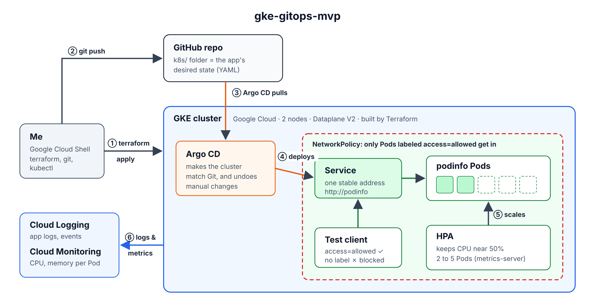

# gke-gitops-mvp

A minimal, observable Kubernetes environment on **Google Kubernetes Engine (GKE)**, built for a take-home exercise.

- **Terraform** creates the network, the GKE cluster and node pool, and installs **Argo CD**.
- **Argo CD** deploys a small demo app (**podinfo**) from the `k8s/` folder of this repo. I never ran `kubectl apply` on the app.
- A **HorizontalPodAutoscaler (HPA)** scales podinfo out under load and back in afterwards.
- A **NetworkPolicy** limits who can reach the app. **GKE Dataplane V2** enforces it.
- All evidence (terminal output with UTC timestamps, plus screenshots) is in [`evidence/`](evidence/).



> **About me and this project:** I'm new to GCP, Terraform and Argo CD. I used an AI assistant (Claude) to learn the concepts, practice some basics and to guide my apporach to solving this problem. I also used AI create test scripts and a draft of README. I typed and ran every command myself, fixed the problems listed in [Problems I hit](#problems-i-hit), and captured all the evidence.

---

## Contents

1. [How it fits together](#how-it-fits-together)
2. [Repository layout](#repository-layout)
3. [Assumptions](#assumptions)
4. [Versions](#versions)
5. [Setup](#setup) and [Destroy](#destroy)
6. [Requirement 1 – Infrastructure (Terraform)](#1-infrastructure-terraform)
7. [Requirement 2 – GitOps (Argo CD)](#2-gitops-argo-cd)
8. [Requirement 3 – Demo app and HPA](#3-demo-app-and-hpa)
9. [Requirement 4 – Security](#4-security)
10. [Requirement 5 – Load test and scaling](#5-load-test-and-scaling)
11. [Requirement 6 – Observability](#6-observability)
12. [Costs and limits](#costs-and-limits)
13. [Known gaps](#known-gaps)
14. [Problems I hit](#problems-i-hit)
15. [Evidence index](#evidence-index)

---

## How it fits together

```
                     git push
   me ───────────────────────────────> GitHub repo (k8s/ folder)
   │                                           │
   │ terraform apply                           │ Argo CD checks Git (~every 3 min)
   v                                           v
 ┌──────────────────── GKE cluster (Dataplane V2) ─────────────────────┐
 │                                                                      │
 │  namespace argocd:   Argo CD  ── syncs ──>  namespace podinfo:       │
 │                                             Deployment (2–5 Pods)    │
 │                                             Service (ClusterIP)      │
 │                                             HPA                      │
 │                                             NetworkPolicy            │
 │                                                  ^                   │
 │  metrics-server ── CPU per Pod ──> HPA ──────────┘ adds/removes Pods │
 └──────────────────────────────────────────────────────────────────────┘
```

**Who owns what:** Terraform owns the platform (network, cluster, nodes, Argo CD). Git and Argo CD own the app. The HPA owns the replica count.

---

## Repository layout

```
terraform/                 Infrastructure + Argo CD bootstrap
  versions.tf              Terraform/provider versions, provider settings
  variables.tf             Settings you can change (region, zone, name, sizing, repo, chart versions)
  main.tf                  VPC, subnet, node service account, GKE cluster, node pool
  argocd.tf                Argo CD install + the Argo CD Application for podinfo
  terraform.tfvars.example Template for your own settings
  .terraform.lock.hcl      Exact provider versions (committed on purpose)
k8s/                       What Argo CD deploys
  deployment.yaml          podinfo: pinned image, probes, requests/limits, security settings
  service.yaml             ClusterIP Service
  hpa.yaml                 HorizontalPodAutoscaler
  networkpolicy.yaml       Ingress restriction
scripts/                   Repeatable tests (they print each command they run)
  networkpolicy-test.sh    One allowed + one denied request
  security-check.sh        Checks non-root user, no API token, security settings
  load-test.sh             Load test + HPA/Pod monitoring + reachability check
  observability-check.sh   Cluster/workload/HPA health and logs via kubectl
evidence/                  Timestamped outputs and screenshots
```

---

## Assumptions

- Everything was run from **Google Cloud Shell** (it has `gcloud`, `kubectl` and `git`; I installed Terraform myself).
- A GCP project (`gke-gitops-mvp`) with billing enabled. Terraform uses my own Google login. **There are no key files anywhere.**
- The GitHub repo is **public**, so Argo CD can read it without a password or token. (A private repo would need a deploy key stored as a Kubernetes Secret.)
- This is a **sandbox**: one zone, two small nodes, and nothing exposed to the internet.

---

## Versions

| Component | Version | Where it's set |
|---|---|---|
| Terraform CLI | 1.16.5 | `required_version = ">= 1.5.0"` in `versions.tf` |
| Google provider (`hashicorp/google`) | **7.46.1** (constraint `~> 7.0`) | `versions.tf`, locked in `.terraform.lock.hcl` |
| Helm provider (`hashicorp/helm`) | **3.3.0** (constraint `~> 3.0`) | `versions.tf`, locked in `.terraform.lock.hcl` |
| GKE / Kubernetes | v1.35.8-gke.1225000 | GKE default at creation time |
| CNI | GKE Dataplane V2 (`ADVANCED_DATAPATH`, Cilium-based) | `main.tf` |
| `argo-cd` Helm chart | 10.10.2 | `variables.tf` |
| `argocd-apps` Helm chart | 2.0.6 | `variables.tf` |
| podinfo image | `ghcr.io/stefanprodan/podinfo:6.15.0` | `k8s/deployment.yaml` |
| fortio (load tool) | `fortio/fortio:1.76.0` | `scripts/load-test.sh` |

**No community module:** I wrote plain Google provider resources instead of using the `terraform-google-modules/kubernetes-engine` module. It's only 6 resources, and I wanted to be able to explain every line.

---

## Setup

```bash
# 1. Choose the project and turn on the 4 Google APIs Terraform needs
gcloud config set project gke-gitops-mvp
gcloud services enable container.googleapis.com compute.googleapis.com \
  cloudresourcemanager.googleapis.com iam.googleapis.com

# 2. Get the code and create your settings file
git clone https://github.com/divyareddyn/gke-gitops-mvp.git
cd gke-gitops-mvp/terraform
cp terraform.tfvars.example terraform.tfvars     # then put your project_id in it
# If you forked the repo, also change git_repo_url in variables.tf

# 3. Create everything (the cluster takes about 10 minutes)
terraform init
terraform plan -out=tfplan
terraform apply tfplan

# 4. Connect kubectl and check
gcloud container clusters get-credentials gke-gitops-mvp --zone us-central1-a --project <PROJECT_ID>
kubectl get nodes                                 # 2 nodes, Ready
kubectl get application podinfo -n argocd         # Synced / Healthy (give it 2-3 minutes)
kubectl get deploy,pods,svc,hpa -n podinfo
```

(I built the cluster first and added Argo CD afterwards.)

### Running the tests

From the repo root, after the app is Synced:

```bash
bash scripts/networkpolicy-test.sh 2>&1 | tee evidence/08-networkpolicy-tests.txt
bash scripts/security-check.sh     2>&1 | tee evidence/09-security-checks.txt
bash scripts/load-test.sh          2>&1 | tee evidence/10-load-test-keepalive.txt   # ~10 minutes
bash scripts/observability-check.sh 2>&1 | tee evidence/11-observability-kubectl.txt
```

## Destroy

```bash
cd terraform
terraform destroy
```

Then confirm nothing is left (see [Destroy and cleanup confirmation](#destroy-and-cleanup-confirmation)).

---

## 1. Infrastructure (Terraform)

### What Terraform creates

| Resource | What it is | Why |
|---|---|---|
| `google_compute_network.vpc` | Custom VPC, no automatic subnets | Only the one subnet I need |
| `google_compute_subnetwork.subnet` | Nodes `10.10.0.0/24`; secondary ranges for Pods `10.20.0.0/16` and Services `10.30.0.0/20` | "VPC-native" networking, which Dataplane V2 requires |
| `google_service_account.nodes` | A dedicated identity for the node VMs | Least privilege (see below) |
| `google_project_iam_member.nodes` | Gives that account only `roles/container.defaultNodeServiceAccount` | The minimum nodes need: write logs and metrics |
| `google_container_cluster.gke` | **Zonal** cluster in `us-central1-a`, **Dataplane V2 on**, default node pool removed | Zonal is cheaper; Dataplane V2 enforces NetworkPolicy |
| `google_container_node_pool.main` | 2 × `e2-medium`, 30 GB standard disk, uses the node service account | Small and cheap, but room for 5 podinfo Pods |
| `helm_release.argocd` | Argo CD (Dex login and notifications turned off to save memory) | GitOps controller |
| `helm_release.podinfo_app` | One Argo CD Application pointing at `k8s/` | Tells Argo CD what to deploy |

Evidence:
- `evidence/01-terraform-plan.txt`: plan, `6 to add`.
- `evidence/02-terraform-apply.txt`: apply. The first attempt failed on the IAM step (see [Problems I hit](#problems-i-hit)); the re-plan then added only the 1 missing resource.
- `evidence/04-argocd-apply.txt`: Argo CD added later, `2 to add`.
- `evidence/03-cluster-check.txt`: 2 nodes `Ready`, `kubectl top nodes` works (metrics-server), and `ADVANCED_DATAPATH`.
- `evidence/terraform_screenshots/`: Terraform install, setup, cluster created, and the API error and fix.

### Configurable settings (`variables.tf`)

`project_id` (required), `region` (`us-central1`), `zone` (`us-central1-a`), `cluster_name` (`gke-gitops-mvp`), `machine_type` (`e2-medium`), `node_count` (`2`), `git_repo_url`, `argocd_chart_version`, `argocd_apps_chart_version`.

### State and credentials

- **State is kept out of Git.** It's stored locally, and `.gitignore` excludes `*.tfstate`, `*.tfstate.*`, `terraform.tfvars`, `.terraform/` and `tfplan`.
- **No credentials in code.** The Google provider uses my `gcloud` login. The Helm provider uses a short-lived Google access token (about 1 hour) from `data.google_client_config`. That token does end up in the local state file, which is one more reason state must never be committed.
- `.terraform.lock.hcl` **is** committed, so everyone gets the same provider versions.

### Least privilege

- The nodes use a **dedicated service account with one minimal role**, not GKE's default compute service account, which has broad project access.
- `oauth_scopes = cloud-platform` looks broad, but it's Google's recommended setting. The real permissions come from the IAM role, not the scope.
- The app Pods get **no Kubernetes API token** (see [Security](#4-security)).

---

## 2. GitOps (Argo CD)

**How it works:** Terraform installs Argo CD and creates one Application:

| Setting | Value | Meaning |
|---|---|---|
| Source | this repo, branch `main`, path `k8s/` | Where the desired state lives |
| Destination | same cluster, namespace `podinfo` | Where to deploy it |
| `automated` | on | Apply Git changes without a manual "Sync" click |
| `prune` | on | If a file is deleted from Git, delete it from the cluster |
| `selfHeal` | on | If someone changes the cluster by hand, put it back to match Git |
| `CreateNamespace=true` | on | Create the `podinfo` namespace if needed |

### First sync

`evidence/05-gitops-first-sync.txt` (22:41 UTC): all Argo CD Pods `Running`; the Application is `Synced` / `Healthy`; 2 podinfo Pods, the Service and the HPA all exist. I did not apply any of these myself.

Right after the first sync, Argo CD briefly showed `Degraded`. The HPA showed `cpu: <unknown>` until metrics-server had readings for the new Pods. It became `Healthy` on its own about 2 minutes later.

### Pushing a change, and identifying what's running

**The change:** I edited `PODINFO_UI_MESSAGE` in `k8s/deployment.yaml` from `"Hello from GitOps MVP"` to `"Hello from GitOps! I am Testing ArgoCD Sync"` and pushed it.

**Evidence that Argo CD applied it** (`evidence/06-gitops-change.txt`):
- **Before:** at 22:47 UTC Argo CD was still synced to the previous commit (`363123a`, not my pushed `5df27fb`). The Pods were from the old ReplicaSet `podinfo-7bc849f6dc-…`, and the app still returned `"Hello from GitOps MVP"`. Argo CD only checks Git every ~3 minutes, so it hadn't picked up the change yet.
- **After:** the last curl in the same file reached a Pod from a **new ReplicaSet**, `podinfo-577968d8fc-rghv9`, which returned `"Hello from GitOps! I am Testing ArgoCD Sync"`. Kubernetes replaced the Pods because Argo CD applied the new environment variable.
- The GKE console shows the Deployment at **Revision 2**, meaning its Pod template changed once since creation (`evidence/observability_screenshots/01-gke-workload.png`).

**Running commit:** `evidence/07-networkpolicy-applied.txt` captures the commit match directly, for the next change I pushed (the NetworkPolicy):

```
Latest commit on GitHub: 93dd302b8f36960af889ae58fe443df3b7044628
Synced 93dd302b8f36960af889ae58fe443df3b7044628
```

The commit Argo CD reports as deployed (`.status.sync.revision`) is exactly the latest commit on GitHub, and the new NetworkPolicy appeared in the cluster.

**Running image version:** `6.15.0`. It shows in two places: the app's own `/version` response (`"version": "6.15.0"`, in file 06) and its startup log (`"version":"6.15.0"`, in file 11).

> **Note:** the `"revision": "dd50717…"` field in podinfo's response is podinfo's **own source code** commit, not this repo's commit. The commit for this repo comes from Argo CD.

---

## 3. Demo app and HPA

| File | Key points |
|---|---|
| `deployment.yaml` | Image pinned to `6.15.0`. **Readiness** probe `/readyz` (stop sending traffic if failing) and **liveness** probe `/healthz` (restart if failing), both every 10 s. **Requests** `50m` CPU / `64Mi`, **limits** `200m` CPU / `128Mi`. **No `replicas` field.** |
| `service.yaml` | `ClusterIP` (inside the cluster only). Port 80 → container port 9898. |
| `hpa.yaml` | `autoscaling/v2`. Target **50%** average CPU (of the 50m request). **Min 2, max 5.** Scale-down stabilization window **60 s** (default is 300 s). |

**Why these numbers:**
- A **small CPU request (50m)** makes scaling easy to trigger in a demo.
- **Min 2** means one Pod can fail and the app stays up.
- **Max 5** caps cost and fits on 2 small nodes.
- **60 s scale-down window** keeps scale-in visible in a short demo. In production I'd keep it longer to avoid flapping.

**Metrics component:** Learnt and observed that GKE ships **metrics-server**, so nothing extra was installed. Verified with `kubectl top nodes` (`evidence/03-cluster-check.txt`) and `kubectl top pods` (`evidence/10-load-test-keepalive.txt`).

---

## 4. Security

### NetworkPolicy

`k8s/networkpolicy.yaml` protects Pods labeled `app: podinfo`. It allows inbound traffic **only** from Pods labeled `access: allowed` in the same namespace, on TCP port 9898. Everything else inbound is dropped.

| | |
|---|---|
| **Enforced by** | **GKE Dataplane V2** (Cilium-based CNI), proven on by `ADVANCED_DATAPATH` in `evidence/03-cluster-check.txt`. Without a policy-capable CNI, Kubernetes would accept this object but nothing would enforce it. |
| **Labels it depends on** | `app: podinfo` on the app Pods (what's protected). `access: allowed` on any client Pod (who's allowed in), including the test Pods and the load generator. |
| **Why port 9898, not 80** | The Service translates port 80 → 9898 **before** the policy is checked, so the policy must use the container's port. |
| **Health probes** | Still work. They come from the node (kubelet), not from another Pod. Both Pods stayed `1/1 Ready` after the policy arrived (`evidence/07-networkpolicy-applied.txt`). |
| **Deployed by** | Argo CD from Git (synced commit `93dd302` = latest GitHub commit). |

**Tests** (`scripts/networkpolicy-test.sh` → `evidence/08-networkpolicy-tests.txt`, 23:24 UTC):

| Test | Command (summary) | Result |
|---|---|---|
| Allowed | curl Pod **with** `access=allowed` → `http://podinfo/healthz` | `{"status": "OK"}` ✅ |
| Denied | same curl Pod **without** the label | `BLOCKED (curl exit code 28)`, a 5-second timeout ✅ |

### Additional security controls

`scripts/security-check.sh` → `evidence/09-security-checks.txt`, checked on the **live** Pod:

| Control | Setting | Verified |
|---|---|---|
| Non-root | `runAsNonRoot: true`, `runAsUser: 10001` | `id` → `uid=10001` |
| No Kubernetes API token | `automountServiceAccountToken: false` | Token folder: `No such file or directory` |
| No privilege escalation | `allowPrivilegeEscalation: false` | in live securityContext |
| No Linux capabilities | `capabilities.drop: ["ALL"]` | in live securityContext |
| Pinned image | `podinfo:6.15.0` | Deployment spec |
| Not internet-facing | Service type `ClusterIP` | `evidence/05-gitops-first-sync.txt` |
| Least-privilege nodes | Dedicated node service account, one minimal role | `terraform/main.tf` |

`runAsUser: 10001` is set as a **number** because podinfo's image names its user (`app`), and Kubernetes can only verify "non-root" against a numeric user ID.

### What remains open

1. **Labels aren't identity.** Anyone allowed to create Pods in `podinfo` can add `access: allowed` and get in. Fix: restrict who can create Pods (RBAC) or enforce labels with an admission policy.
2. **No egress policy and no namespace-wide default-deny.** The app can call out anywhere, and other Pods in the namespace aren't covered.
3. **Image pinned by tag, not digest**, and no signature check (cosign). A tag can be re-pushed; a digest can't.
4. **Nothing forces these settings on every Pod.** No Pod Security Admission `restricted` label and no policy engine (Kyverno/Gatekeeper). Only podinfo has them because I wrote them in.
5. **Group is still root:** `gid=0` (`runAsGroup` not set), and the root filesystem is writable (`readOnlyRootFilesystem` not set).
6. **Argo CD** uses its default admin account and the `default` project (no restrictions).

---

## 5. Load test and scaling

`scripts/load-test.sh` → `evidence/10-load-test-keepalive.txt` (timeline), `evidence/10-load-fortio-results-keepalive.txt` (fortio report), `evidence/10-load-reachability-keepalive.txt` (health checks).

### Method

| | |
|---|---|
| Load tool | **fortio 1.76.0**, run as a Pod **inside the cluster** (labeled `access=allowed`) |
| Load | **4 concurrent connections**, no rate limit (`-qps 0`), for **180 s**, against `http://podinfo/` |
| Reachability check | A separate curl Pod calls `/healthz` every **2 s** for the whole test and records the HTTP code |
| Recording | Every 15 s: HPA CPU %, desired/current/ready replicas, Pending Pods, loadgen state, and **CPU per Pod** (`kubectl top pods`) |
| Repeatable | All settings are at the top of the script |

### Results
This block has been summarized from test logs by using AI assistant(Claude)
| Item | Result |
|---|---|
| HPA target | 50% of the 50m CPU request; min 2, max 5; 60 s scale-down window |
| Baseline | 2 Pods, 1m CPU each |
| Load start | **00:45:45 UTC** |
| Requests | **336,666** in 180 s (**1,869.8 req/s**), **100% HTTP 200**, 0 errors |
| Latency | p50 0.60 ms · p90 0.99 ms · **p99 76 ms** · max 97 ms |
| HPA decides 2 → 5 | ~**00:46:06** (from HPA event), **~21 s** after load start |
| All 5 Pods Ready | **00:46:34**, **~49 s** after load start |
| Peak | **5 replicas**; **397%** average CPU (as % of request) |
| Pending Pods | **0** the whole time |
| Load stop | **00:48:46 UTC** (fortio ran 3 m 0.05 s) |
| Scale-in | **5 → 3** at ~00:50:19, then **3 → 2** at ~00:50:49 |
| Back to baseline | **~123 s** after load stopped |
| Reachability | **287 checks** (00:45:44 – 00:55:23), **0 failures** |

The event times come from `kubectl describe hpa` (taken at 00:55:23, minus each event's age). They're more precise than the 15-second table rows.

### Interpretation

**Scale-out worked quickly.** The HPA's formula is `current Pods × (current CPU ÷ target)`. At the first high reading: 2 × (219 ÷ 50) ≈ 9 → capped at `maxReplicas` = **5**, so it jumped straight to 5.

**CPU above 100% is normal here.** The percentage is measured against the **request** (50m), not a whole CPU. Each Pod may use up to its **limit** (200m), which is **400%**. 397% means "at the limit."

**Scale-in happened in two steps because of the 60 s window.** When scaling down, the HPA uses the **highest** recommendation from the last 60 seconds. After load stopped, CPU went 82% → 23% → 1%. While 82% (→ 5 Pods) was in the window it kept 5. When that aged out, 23% (→ 3 Pods) was the highest, so 5 → 3. Then 1% (→ minimum 2), so 3 → 2.

**The app stayed reachable:** at least 2 Pods were always running, and readiness probes kept traffic away from Pods that weren't ready yet. All 287 health checks and all 336,666 load requests returned 200.

### Finding: the new Pods received almost no load

CPU per Pod during the load (e.g. 00:47:38):

```
podinfo-577968d8fc-hgdgn  199m   ← original Pod, at its 200m limit
podinfo-577968d8fc-nvlxd  199m   ← original Pod, at its 200m limit
podinfo-577968d8fc-6lxfc    1m   ← new Pod, idle
podinfo-577968d8fc-9vgcf    1m   ← new Pod, idle
podinfo-577968d8fc-zx8d6    1m   ← new Pod, idle
```

**Why - Possible Reasoning:**
1. fortio opened its **4 connections once**, at the start, and sent all 336,666 requests over them ("keepalive"). Its report says `Sockets used: 4`.
2. A Kubernetes Service chooses a Pod **when a connection is opened**, not for each request.
3. When fortio connected, **only 2 Pods existed**, so all 4 connections stayed on those 2 Pods. The 3 new Pods never received a fortio connection. They only got the reachability checker's requests, because curl opens a new connection each time.

**The numbers agree:**
- The HPA's **397%** was the average of the 2 busy Pods only, before the new Pods had CPU readings.
- The later **160%** = (199 + 199 + 1 + 1 + 1) ÷ 5 ≈ 80m ÷ 50m. The average dropped because 3 idle Pods joined it, not because work spread out.
- fortio's per-connection counts split 1 + 3 (162,546 calls on one connection vs ~58,000 on each of the other three), consistent with one connection on one Pod and three sharing the other. Both Pods were capped at the same 200m.
- **p99 latency of 76 ms** (vs p50 0.6 ms) is consistent with the 2 Pods being **CPU-throttled** at their limit.

**What it means:** the HPA worked exactly as designed: high average CPU → more Pods, low CPU → fewer Pods. But **new Pods only help new connections.** With a few long-lived connections, scaling out added capacity the existing traffic couldn't use, and the **average CPU hid 2 saturated Pods**.

---

## 6. Observability

`scripts/observability-check.sh` → `evidence/11-observability-kubectl.txt`; screenshots in `evidence/observability_screenshots/`.

### Where to look

| What | kubectl | Google Cloud console |
|---|---|---|
| **Cluster health** | `kubectl get nodes` (Ready?), `kubectl top nodes` (CPU/memory) | Kubernetes Engine → Clusters |
| **Workload health** | `kubectl get application podinfo -n argocd` (Synced/Healthy); `kubectl get deploy,pods -n podinfo` (ready count, **restarts**) | Kubernetes Engine → Workloads → podinfo (`01-gke-workload.png`) |
| **Per-Pod CPU/memory** | `kubectl top pods -n podinfo` (live only) | Monitoring → Metrics Explorer → *Kubernetes Container – CPU usage time*, filter `namespace_name = podinfo` (`03-gke-cpu-per-pod.png`) |
| **HPA metrics and events** | `kubectl get hpa` (current vs target); `kubectl describe hpa` (Conditions and scaling Events) | Workloads → podinfo → Scaling |
| **Kubernetes events** | `kubectl get events -n podinfo --sort-by=.lastTimestamp` | Logging (event logs) |
| **Application logs** | `kubectl logs -n podinfo -l app=podinfo --prefix` | Logging → Logs Explorer (`02-gke-logging-explorer.png`) with `resource.type="k8s_container"` `resource.labels.namespace_name="podinfo"` |

GKE sends container logs to Cloud Logging and system metrics to Cloud Monitoring by default. The node service account's role from Terraform is what allows the nodes to write them.

**About the CPU screenshot:** it shows **total** CPU for the `podinfo` namespace (aggregation *Sum*, not grouped). That includes the fortio and curl test Pods. The spikes are the load-test runs.
### What I observed

- **Events expire.** At 02:12 UTC, about 1.5 hours after the load test, `kubectl describe hpa` showed `Events: <none>` and `kubectl get events` found nothing. Kubernetes only keeps events for about 1 hour. The scaling events are only in my evidence because the load-test script captured `describe hpa` at the time.
- **No per-request logs.** podinfo logged only its startup lines (including `"version":"6.15.0"`), even after 700,000+ requests across my load tests. Request-level data came only from fortio's report.
- **The workload is healthy:** `Synced` / `Healthy`, 2/2 Pods, 0 restarts, HPA at baseline (`evidence/11-observability-kubectl.txt`).

### The one alert I'd add for production

**A warning alert I *can* build today with existing GKE metrics:** any single podinfo container above 90% of its CPU limit for 5 minutes (`kubernetes.io/container/cpu/limit_utilization > 0.9`). My load test showed the HPA's average can hide saturated Pods, so this catches what the average misses. I'd send it as a ticket or slack warning, not a page.

### One SLO for production

**Availability SLO:** 99.5% of HTTP requests to podinfo return a non-5xx response, measured over a rolling 30 days.

### Signals not available here, and how I'd expose them in a customer-controlled environment

| Signal | In this sandbox | How to expose it |
|---|---|---|
| CPU/memory per node and container | ✅ `kubectl top`; Cloud Monitoring | Same, or the customer's monitoring tool |
| Container logs | ✅ Cloud Logging | Send to the customer's log platform with their retention and access rules |
| Kubernetes events | ⚠️ ~1 hour in the cluster | Export events to the logging platform |
| **Request rate, errors, latency** | ❌ only fortio, only during the test | Scrape podinfo's `/metrics` endpoint with Google Managed Prometheus or kube-prometheus-stack |
| **Per-request logs** | ❌ podinfo doesn't log them | Raise the app's log level, or collect access logs at an ingress |
| HPA status as a metric (e.g. "stuck at max") | ❌ `kubectl describe` only | kube-state-metrics |
| Argo CD sync/health as metrics | ❌ UI and kubectl only | Scrape Argo CD's metrics; alert on OutOfSync / Degraded |
| Dashboards and alert routing | ❌ none | Grafana or Cloud Monitoring dashboards; Alertmanager or alert policies to the customer's on-call tool |
| Tracing | ❌ none | OpenTelemetry (needs app instrumentation) |

"**Customer-controlled**" means the data stays in the customer's own project or account, with their retention, their access control and their on-call routing. I'd define alerts **as code** (e.g. Terraform `google_monitoring_alert_policy`) so they're reviewed and reproducible like everything else.

---

## Costs and limits

**Estimated cost: about $1.70 per day while running** (2 × `e2-medium` on-demand in `us-central1` plus 60 GB of standard disk, at list prices). 

- The GKE management fee for one **zonal** cluster is covered by GKE's free tier.
- **No** load balancer, Cloud NAT or static IP was created, because the Service is ClusterIP only.
- Logs and metrics stayed within Cloud Logging and Cloud Monitoring free allotments at this volume (my assumption, not checked).

**Limits (on purpose, for a demo):**
- Single zone, so a zone outage takes everything down.
- Fixed 2 nodes, no node autoscaling. More than ~5 small Pods would sit in Pending.
- `maxReplicas: 5` and a 200m CPU limit make scaling visible but cap throughput.
- Local Terraform state: only one person can manage it, and losing Cloud Shell's home folder would lose it.

---

## Known gaps

What I would add before calling this production-ready:

- **Terraform:** remote state in a GCS bucket with locking; separate state per environment.
- **Cluster:** private cluster with restricted control-plane access; Workload Identity; regional cluster; node autoscaling;
- **Argo CD:** SSO instead of the admin account; a restricted AppProject; app-of-apps or ApplicationSets for multiple apps and environments.
- **Security:** everything in [What remains open](#what-remains-open).
- **Observability:** Prometheus metrics, dashboards, and the SLO alert from section 6.
- **Not done:** I didn't run the separate "drift / self-heal" demo (deleting a resource by hand and watching Argo CD restore it)

---

## Problems I hit

| Problem | Cause | What I did |
|---|---|---|
| `terraform: command not found` in Cloud Shell | Terraform isn't preinstalled | Installed 1.16.5 from HashiCorp's apt repository; copied the binary to `~/bin` so it survives Cloud Shell restarts |
| `terraform apply` failed: `Error 403 … Cloud Resource Manager API has not been used … SERVICE_DISABLED` on the IAM member | New projects have most APIs off; Terraform needs this one to change IAM | Enabled `cloudresourcemanager` and `iam` APIs, then re-planned. Terraform only created the 1 missing resource. Screenshot `9-gke-terraform-cluster-error-fix.png` |
| `Duplicate required providers configuration` | I had both `version.tf` and `versions.tf`. **Terraform reads every `.tf` file in a folder as one configuration** | Removed the old file with `git rm` |
| Argo CD showed `Degraded` right after first sync | HPA had no CPU readings yet (`<unknown>`) | Waited ~2 minutes; it became `Healthy` on its own |
| My first GitOps check showed the old commit and old message | Argo CD checks Git only every ~3 minutes | Waited and checked again; the new Pods had the new message |
| NetworkPolicy wasn't in the cluster right after I pushed it | Argo CD was still on the previous commit | Checked `git log` against GitHub, waited for Argo CD, re-captured with the GitHub SHA next to the synced SHA (file 07) |
| `tee: evidence/…: No such file or directory` | I ran the command from `terraform/`, not the repo root | `cd ~/gke-gitops-mvp` first |
| HPA showed 160% CPU with 5 Pods, but adding Pods didn't lower it as expected | Keepalive connections stayed on the 2 original Pods | Added per-Pod CPU to the load-test script and re-ran to confirm (section 5) |

---

## Destroy and cleanup confirmation

```bash
cd ~/gke-gitops-mvp/terraform
{ date -u; terraform destroy -auto-approve; } 2>&1 | tee ../evidence/12-terraform-destroy.txt

cd ~/gke-gitops-mvp
{
  date -u
  gcloud container clusters list
  gcloud compute networks list --filter="name~gke-gitops-mvp"
  gcloud compute disks list
  gcloud compute instances list
  gcloud iam service-accounts list --filter="email~gke-gitops-mvp-nodes"
} 2>&1 | tee evidence/13-cleanup-check.txt
```

- `evidence/12-terraform-destroy.txt`
- `evidence/13-cleanup-check.txt`

---

## Evidence index

| File | What it shows |
|---|---|
| `01-terraform-plan.txt` | Plan for the 6 infrastructure resources |
| `02-terraform-apply.txt` | Cluster created; re-plan after the API error adds only the IAM member |
| `03-cluster-check.txt` | 2 nodes Ready, `kubectl top nodes`, `ADVANCED_DATAPATH` |
| `04-argocd-apply.txt` | Argo CD + Application installed by Terraform (2 added) |
| `05-gitops-first-sync.txt` | Argo CD Synced/Healthy; app objects created by Argo CD |
| `06-gitops-change.txt` | Message change: old Pods/message before, new ReplicaSet and new message after; image version 6.15.0 |
| `07-networkpolicy-applied.txt` | **Synced SHA = latest GitHub SHA**; NetworkPolicy created; Pods still Ready |
| `08-networkpolicy-tests.txt` | Allowed (200 OK) and denied (timeout) tests |
| `09-security-checks.txt` | uid 10001, no API token, live security settings |
| `10-load-test-keepalive.txt` | Scaling timeline with per-Pod CPU, HPA events |
| `10-load-fortio-results-keepalive.txt` | 336,666 requests, 100% 200, latency, 4 sockets |
| `10-load-reachability-keepalive.txt` | 287 health checks, all 200 |
| `11-observability-kubectl.txt` | Health, HPA, expired events, startup-only logs |
| `terraform_screenshots/1–7` | Terraform install and project setup in Cloud Shell |
| `terraform_screenshots/8` | Cluster created |
| `terraform_screenshots/9` | The 403 API error and the fix |
| `observability_screenshots/01-gke-workload.png` | Deployment healthy, 2/2 ready, HPA OK, Revision 2 |
| `observability_screenshots/02-gke-logging-explorer.png` | podinfo container logs in Cloud Logging |
| `observability_screenshots/03-gke-cpu-per-pod.png` | Namespace CPU over time; spikes = load-test runs |
